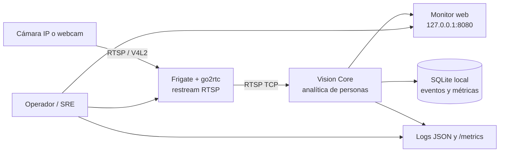
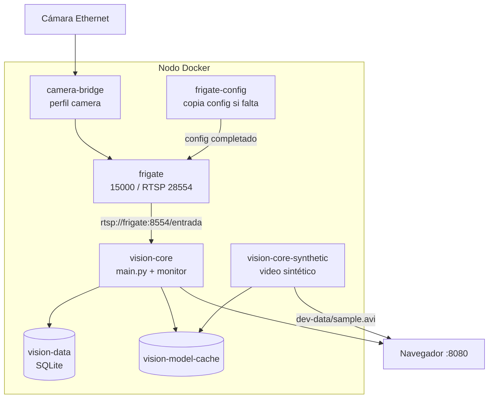
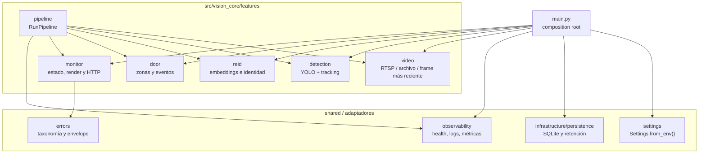
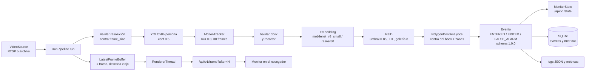

# Diagramas (Mermaid)

Representación C4 en Mermaid (`flowchart`) para que los diagramas se versionen
como texto y se revisen en el mismo PR que el código. Se actualizan cuando
cambia el cableado en `main.py`, los adaptadores o los endpoints.

## C4 — Contexto

Vision Core no sustituye a Frigate: Frigate entrega video y Vision Core hace su
propia detección, ReID y generación de eventos. Fuera de alcance: sitio web
externo y sincronización entre nodos.

## C4 — Contenedores

El stack por defecto levanta `vision-core-synthetic`; el perfil `camera`
levanta `camera-bridge`, `frigate-config`, `frigate` y `vision-core`. Ver
[startup.md](startup.md) y [docker-compose.yml](../docker-compose.yml).

## C4 — Componentes

Un feature nunca importa la infraestructura de otro: se comunica mediante
puertos y DTOs. Las reglas se comprueban en
`tests/architecture/test_import_rules.py`; el detalle está en
[architecture.md](architecture.md).

## Flujo de datos

Código de referencia: `src/vision_core/features/pipeline/application/use_cases/run_pipeline.py`,
`src/vision_core/features/door/infrastructure/analytics/`,
`src/vision_core/features/monitor/infrastructure/` y
[main.py](../main.py). Con `VISION_CORE_MONITOR_UNCALIBRATED=1` se omite la
analítica de zonas y no se generan cruces; con
`VISION_CORE_RENDER_ENABLED=0` se omite la rama de render/JPEG.

## Cómo mantener estos diagramas

1. Cambias un adaptador o un endpoint → actualiza el diagrama afectado en el
   mismo PR.
2. Cambias una decisión estructural → añade o enmienda un ADR y enlázalo desde
   [el índice](adr/README.md).
3. Antes de mergear, verifica que los nombres de features, servicios y rutas
   HTTP siguen existiendo; los comandos están en
   [onboarding.md](onboarding.md#4-comandos-que-usarás).
