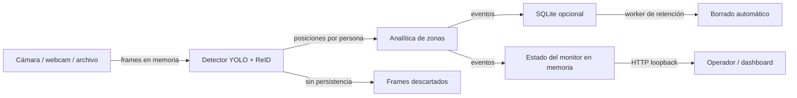

# Política de privacidad y retención de video y eventos

Este documento define la finalidad, la base legal operativa, la minimización,
el acceso y los plazos de retención de Vision Core. Es una política técnica;
la validación legal formal está registrada en `docs/legal-review.md`.

## Finalidad y base legal

Finalidad: detectar y contabilizar personas en zonas configuradas, generando
eventos `PERSON_ENTERED`, `PERSON_EXITED` y `FALSE_ALARM` para analítica de
aforo y puerta.

La base legal depende del contexto de despliegue y debe ser decidida por el
responsable del tratamiento:

- consentimiento informado, cuando las personas puedan optar por no entrar;
- interés legítimo, cuando el tratamiento sea necesario y proporcional para
  seguridad o gestión de aforo y se haya realizado evaluación de impacto;
- obligación legal, solo si aplica normativa sectorial específica.

Vision Core no decide esa base legal por sí mismo. Antes de producción debe
quedar registrada en `docs/legal-review.md`.

## Aviso a las personas en la sala

Señalización mínima recomendada en la entrada:

> Esta instalación procesa imágenes de video para contabilizar personas y
> generar eventos de acceso. No se guardan imágenes de video. Los eventos se
> conservan solo durante el plazo establecido en la política de retención.
> Responsable y contacto: `<completar antes de producción>`.

La señal debe ser visible antes de entrar a la zona cubierta. Si la base legal
es consentimiento, el cartel debe incluir la forma de ejercerlo.

## Minimización

- No se guarda video ni frames en disco por defecto. Solo existen en memoria
  mientras se procesan.
- `/api/frame` devuelve un JPEG efímero para el visor; no se persiste.
- Los eventos guardan `person_id`, tipo de evento, timestamp, zonas de origen
  y destino, posición y contadores de asistencia. No guardan imágenes de rostro.
- Los logs estructurados no incluyen frames ni crops; el evento serializado
  usa la misma forma que la API (`event_to_json_dict`). No se registran datos
  personales adicionales en mensajes de error (coordinado con ticket 31).

## Flujo de datos



## Retención

La persistencia está desactivada salvo que se configure `VISION_CORE_DB_PATH`.
Cuando está activa, `RetentionWorker` ejecuta `RetentionJob` cada
`VISION_CORE_DB_PRUNE_INTERVAL_SECONDS` (por defecto 3600 s) y registra
`last_result` con el número de filas borradas por tipo.

| Dato | Configuración | Plazo por defecto | Borrado |
|---|---|---|---|
| Video/frames | no configurable; nunca se escriben | 0 (memoria) | al descartar el frame |
| JPEG del visor | no configurable | 0 (memoria) | respuesta HTTP / cierre |
| Eventos | `VISION_CORE_EVENT_TTL_SECONDS` | 30 días | `RetentionJob` |
| Observaciones de zona | `VISION_CORE_HISTORY_TTL_SECONDS` | 7 días | `RetentionJob` |
| Embeddings/identidades | `VISION_CORE_IDENTITY_TTL_SECONDS` | 1 día | `RetentionJob` |
| Tracks | `VISION_CORE_TRACK_TTL_SECONDS` | 1 día | `RetentionJob` |
| Sesiones | `VISION_CORE_SESSION_TTL_SECONDS` | 30 días | `RetentionJob` |
| Métricas | `VISION_CORE_METRICS_TTL_SECONDS` | 30 días | `RetentionJob` |
| Logs | rotación externa (pendiente) | objetivo 30 días | pendiente de implementar |

Un TTL de `0` desactiva el borrado por tiempo de ese tipo; debe usarse solo con
autorización legal y una política compensatoria documentada.

### Verificación del borrado

Tras un intervalo mayor que el TTL, comprobar que no quedan filas viejas:

```bash
python - <<'PY'
import sqlite3, time
conn = sqlite3.connect("/app/data/vision-core.sqlite3")
for table, column in (("events", "timestamp_utc"), ("tracks", "updated_at_utc")):
    cutoff = time.time() - 30 * 86400
    print(table, conn.execute(f"SELECT COUNT(*) FROM {table} WHERE {column} < ?", (cutoff,)).fetchone()[0])
PY
```

También puede verificarse con el resultado del job en el proceso:

```python
result = retention_job.last_result
print(result.events, result.identities, result.total)
```

`docs/persistence.md` describe el esquema y las consultas adicionales.

## Acceso y exposición

- El monitor escucha en `127.0.0.1` por defecto (`VISION_CORE_MONITOR_HOST`).
- Los archivos Compose publican los puertos solo en `127.0.0.1`.
- `0.0.0.0` es una decisión explícita y produce una advertencia; dentro de
  Docker puede ser necesario, pero el control real es la publicación del puerto.
- Antes de publicar en LAN o Internet se requiere el ticket 42: autenticación,
  RBAC, TLS y registro de accesos. Sin esos controles, cualquier cliente que
  alcance el puerto puede ver video y eventos de personas; no se asume que la
  red de Docker aisla suficiente.
- Los tickets 46 (límites HTTP) y 47 (headers) son complementarios.

Verificación local:

```bash
ss -ltnp | grep 8080              # debe mostrar 127.0.0.1:8080
docker compose port vision-core 8080   # debe devolver 127.0.0.1:<puerto>
```

## Responsable y solicitudes

- Responsable del tratamiento: `<completar antes de producción>`.
- Contacto de privacidad: `<completar antes de producción>`.
- Procedimiento: la persona puede solicitar acceso, rectificación, supresión,
  limitación o portabilidad al contacto indicado. La respuesta debe identificar
  los datos por `person_id` o rango temporal, aplicar la supresión en SQLite y
  dejar evidencia de la acción en el registro de solicitudes.
- Plazo objetivo de respuesta: 30 días, sujeto a la normativa aplicable.

## Riesgos y pendientes

| Riesgo / pendiente | Estado | Mitigación |
|---|---|---|
| AGPL de Ultralytics en distribución/SaaS | Abierto | Decisión en `THIRD_PARTY_NOTICES.md`; licencia comercial, sustitución del detector o publicación AGPL |
| Base legal y responsable sin completar | Abierto | Completar `docs/legal-review.md` antes de producción |
| Rotación de logs de 30 días | Abierto | Configurar rotación/colector en despliegue |
| Registro de accesos al monitor | Abierto | Ticket 42 |
| Auth/TLS fuera de localhost | Abierto | Ticket 42; no publicar hasta implementarlo |
| Anonimización avanzada de rostros | Fuera de alcance | Ticket posterior |
| Certificaciones ISO/SOC2 | Fuera de alcance | No requeridas por este ticket |
