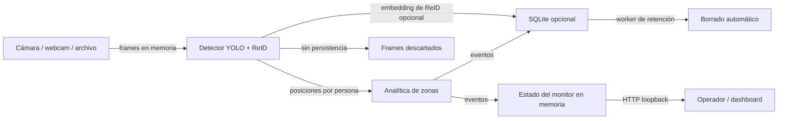

# Política de privacidad y retención de video y eventos

Este documento define la finalidad, la base legal operativa, la minimización,
el acceso y los plazos de retención de Vision Core. Es una política técnica;
la validación legal formal está registrada en `docs/legal-review.md`.

## Finalidad y base legal

Finalidad: detectar y contabilizar personas en zonas configuradas, generando
eventos `PERSON_ENTERED`, `PERSON_EXITED` y `FALSE_ALARM` para analítica de
aforo y puerta.

La base legal depende del contexto de despliegue y debe ser decidida por el
responsable del tratamiento:

- consentimiento informado, cuando las personas puedan optar por no entrar;
- interés legítimo, cuando el tratamiento sea necesario y proporcional para
  seguridad o gestión de aforo y se haya realizado evaluación de impacto;
- obligación legal, solo si aplica normativa sectorial específica.

Vision Core no decide esa base legal por sí mismo. Antes de producción debe
quedar registrada en `docs/legal-review.md`.

## Aviso a las personas en la sala

Señalización mínima recomendada en la entrada:

> Esta instalación procesa imágenes de video para contabilizar personas y
> generar eventos de acceso. El monitor no conserva video. Los eventos se
> conservan solo durante el plazo establecido en la política de retención.
> Responsable y contacto: `<completar antes de producción>`.

La señal debe ser visible antes de entrar a la zona cubierta. Si la base legal
es consentimiento, el cartel debe incluir la forma de ejercerlo.

## Minimización

- El monitor no escribe video ni frames en disco; solo existen en memoria
  mientras se procesan.
- Las utilidades explícitas `capture_reference`, `check_zones`,
  `create_pipeline_sample` y `create_benchmark_video` pueden escribir PNG/AVI
  locales para calibración o pruebas. No forman parte del flujo productivo, pero
  sus artefactos deben borrarse o tratarse como datos personales.
- `/api/frame` devuelve un JPEG efímero para el visor; no se persiste.
- Los eventos guardan `person_id`, tipo de evento, timestamp, zonas de origen
  y destino, posición y contadores de asistencia. No guardan imágenes de rostro.
- Cuando hay persistencia activa, `identity_gallery.embedding_json` conserva
  embeddings de ReID asociados a `person_id`; son datos biométricos operativos
  y requieren la base legal registrada en `docs/legal-review.md`.
- Los logs estructurados no incluyen frames ni crops; el evento serializado
  usa la misma forma que la API (`event_to_json_dict`). `person_id` sí se
  propaga a los logs (`structured_logging.py` y `state.py`), por lo que debe
  tratarse como identificador seudónimo; su retención sigue pendiente
  (coordinado con ECM-87 y ticket 31).

## Flujo de datos



## Retención

La persistencia se activa si `VISION_CORE_DB_PATH` está definido o si
`VISION_CORE_DB_ENABLED=1` (en ese caso usa `vision-core.sqlite3` por defecto).
`VISION_CORE_DB_ENABLED=0` la desactiva explícitamente. Cuando está activa,
`RetentionWorker` ejecuta `RetentionJob` cada
`VISION_CORE_DB_PRUNE_INTERVAL_SECONDS` (por defecto 3600 s) y registra
`last_result` con el número de filas borradas por tipo.

| Dato | Configuración | Plazo por defecto | Borrado |
|---|---|---|---|
| Video/frames del monitor | no configurable; el monitor nunca los escribe | 0 (memoria) | al descartar el frame |
| Capturas de utilidades | no configurable; artefactos locales de calibración/prueba | sin plazo automático | borrado manual; tratar como dato personal |
| JPEG del visor | no configurable | 0 (memoria) | respuesta HTTP / cierre |
| Eventos | `VISION_CORE_EVENT_TTL_SECONDS` | 30 días | `RetentionJob` |
| Observaciones de zona | `VISION_CORE_HISTORY_TTL_SECONDS` | 7 días | `RetentionJob` |
| Embeddings (`identity_gallery`) | `VISION_CORE_IDENTITY_TTL_SECONDS` | 1 día | `RetentionJob` |
| Personas (`persons`) | `VISION_CORE_IDENTITY_TTL_SECONDS` | 1 día | `RetentionJob` |
| Tracks | `VISION_CORE_TRACK_TTL_SECONDS` | 1 día | `RetentionJob` |
| Sesiones | `VISION_CORE_SESSION_TTL_SECONDS` | 30 días | `RetentionJob` |
| Métricas | `VISION_CORE_METRICS_TTL_SECONDS` | 30 días | `RetentionJob` |
| Logs con `person_id` | rotación externa (pendiente) | objetivo 30 días | pendiente de implementar |

Un TTL de `0` desactiva el borrado por tiempo de ese tipo; debe usarse solo con
autorización legal y una política compensatoria documentada.

### Verificación del borrado

Tras un intervalo mayor que el TTL **y** al menos un ciclo de
`VISION_CORE_DB_PRUNE_INTERVAL_SECONDS`, comprobar que no quedan filas viejas.
Cada consulta debe usar la columna de retención y el TTL configurado para ese
tipo:

```bash
python - <<'PY'
import os
import sqlite3
import time

from vision_core.core.config.persistence import PersistenceSettings

settings = PersistenceSettings.from_env(dict(os.environ))
conn = sqlite3.connect(os.environ.get("VISION_CORE_DB_PATH", "vision-core.sqlite3"))
now = time.time()
checks = (
    ("events", "SELECT COUNT(*) FROM events WHERE timestamp_utc < ?", settings.event_ttl_seconds),
    ("zone_observations", "SELECT COUNT(*) FROM zone_observations WHERE timestamp_utc < ?", settings.history_ttl_seconds),
    ("tracks", "SELECT COUNT(*) FROM tracks WHERE timestamp_utc < ?", settings.track_ttl_seconds),
    ("identity_gallery", "SELECT COUNT(*) FROM identity_gallery WHERE last_seen_at_utc < ?", settings.identity_ttl_seconds),
    ("persons", "SELECT COUNT(*) FROM persons WHERE last_seen_utc < ?", settings.identity_ttl_seconds),
    ("sessions", "SELECT COUNT(*) FROM sessions WHERE started_at_utc < ?", settings.session_ttl_seconds),
    ("metrics", "SELECT COUNT(*) FROM metrics WHERE timestamp_utc < ?", settings.metrics_ttl_seconds),
)
for label, query, ttl in checks:
    if ttl <= 0:
        print(f"{label}: disabled")
        continue
    print(f"{label}: {conn.execute(query, (now - ttl,)).fetchone()[0]}")
conn.close()
PY
```

También puede verificarse con el resultado del job en el proceso:

```python
result = retention_job.run_once()
print(
    result.events,
    result.zone_observations,
    result.tracks,
    result.identities,
    result.persons,
    result.sessions,
    result.metrics,
    result.total,
)
```

`docs/persistence.md` describe el esquema y las consultas adicionales.

## Acceso y exposición

- El proceso Python escucha en `127.0.0.1` si no se define
  `VISION_CORE_MONITOR_HOST`.
- La imagen Docker fija `0.0.0.0` en `Dockerfile` y los archivos Compose también
  lo configuran dentro del contenedor; no debe afirmarse que el contenedor
  escucha en localhost.
- Los archivos Compose publican los puertos solo en `127.0.0.1` del host, que es
  el control efectivo de exposición.
- `0.0.0.0` dentro del contenedor es necesario para el port mapping; hoy no
  genera advertencia automática en runtime.
- **Pendiente bloqueante antes de exponer fuera de localhost (criterio ECM-87):**
  autenticación, RBAC, TLS y registro de accesos. Sin esos controles, cualquier
  cliente que alcance el puerto puede ver video y eventos de personas; no se
  asume que la red de Docker aísla suficiente.
- Los tickets 42 (criterio original), 46 (límites HTTP) y 47 (headers) son
  complementarios, no sustitutos de los controles de acceso.

Verificación local:

```bash
ss -ltnp | grep 8080              # debe mostrar 127.0.0.1:8080
docker compose port vision-core 8080   # debe devolver 127.0.0.1:<puerto>
```

## Responsable y solicitudes

- Responsable del tratamiento: `<completar antes de producción>`.
- Contacto de privacidad: `<completar antes de producción>`.
- Procedimiento **pendiente de implementar antes de producción**: la persona
  podrá solicitar acceso, rectificación, supresión, limitación o portabilidad al
  contacto indicado. La respuesta deberá identificar los datos por `person_id` o
  rango temporal, aplicar la supresión en SQLite y dejar evidencia de la acción
  en el registro de solicitudes.
- Estado: documentado pero sin tooling ni registro operativo; bloqueante según
  `docs/legal-review.md`.
- Plazo objetivo de respuesta: 30 días, sujeto a la normativa aplicable.

## Riesgos y pendientes

| Riesgo / pendiente | Estado | Mitigación |
|---|---|---|
| AGPL de Ultralytics en distribución/SaaS | Abierto | Decisión en `THIRD_PARTY_NOTICES.md`; publicación GHCR bloqueada por defecto; licencia comercial, sustitución del detector o publicación AGPL |
| Base legal y responsable sin completar | Abierto | Completar `docs/legal-review.md` antes de producción |
| Embeddings como dato biométrico | Abierto | Registrar base legal, DPIA y plazo de `identity_gallery` antes de producción |
| `person_id` en logs y rotación de 30 días | Abierto | Definir retención real y configurar rotación/colector en despliegue |
| Procedimiento de derechos sin implementar | **Bloqueante abierto** | Implementar búsqueda/supresión por `person_id` y registro de evidencia |
| Artefactos PNG/AVI de utilidades | Abierto | Borrar capturas de prueba o gobernarlas como datos personales |
| Acceso restringido fuera de localhost (auth, RBAC, TLS, registro de accesos) | **Bloqueante abierto** | ECM-87 y tickets 42/46/47; no publicar hasta implementarlo |
| Anonimización avanzada de rostros | Fuera de alcance | Ticket posterior |
| Certificaciones ISO/SOC2 | Fuera de alcance | No requeridas por este ticket |
